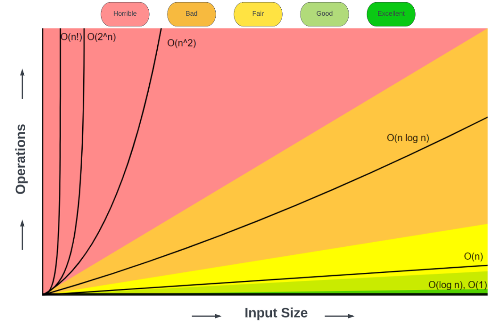
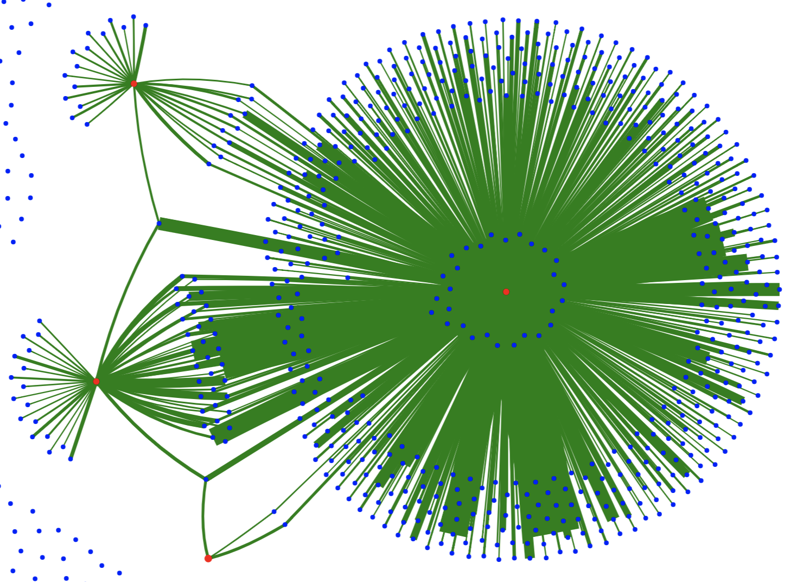
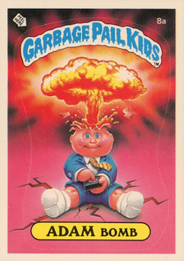

```{=html}
<script src="https://cdn.jsdelivr.net/npm/chart.js"></script>
<style>
  .plot-button {
    background-color: #2E86C1;
    color: white;
    padding: 10px 20px;
    border: none;
    border-radius: 5px;
    cursor: pointer;
    font-size: 16px;
    margin: 10px 5px;
    transition: background-color 0.3s;
  }
  .plot-button:hover {
    background-color: #1A5490;
  }
  .chart-container {
    position: relative;
    height: 400px;
    width: 80%;
    margin: 20px auto;
  }
  .comparison-container {
    position: relative;
    height: 500px;
    width: 90%;
    margin: 20px auto;
  }
</style>

<script>
function generateComplexityData(type, n, maxValue = null) {
  const data = [];
  for (let i = 1; i <= n; i++) {
    let value;
    switch(type) {
      case 'O(1)':
        value = 1;
        break;
      case 'O(log n)':
        value = Math.log2(i);
        break;
      case 'O(n)':
        value = i;
        break;
      case 'O(n²)':
        value = i * i;
        break;
      case 'O(2ⁿ)':
        // For exponential, calculate only if i is within safe range
        if (i <= 20) {
          value = Math.pow(2, i);
        } else {
          // Stop generating data after 20 for exponential to avoid overflow
          break;
        }
        break;
      default:
        value = i;
    }
    data.push({x: i, y: value});
  }
  return data;
}

function plotComplexity(canvasId, complexityType, color) {
  const ctx = document.getElementById(canvasId);
  if (!ctx) return;
  
  // Destroy existing chart if it exists
  if (window[canvasId + '_chart']) {
    window[canvasId + '_chart'].destroy();
  }
  
  const maxN = complexityType === 'O(2ⁿ)' ? 20 : 100;
  const data = generateComplexityData(complexityType, maxN);
  
  window[canvasId + '_chart'] = new Chart(ctx, {
    type: 'line',
    data: {
      datasets: [{
        label: complexityType,
        data: data,
        borderColor: color,
        backgroundColor: color + '33',
        borderWidth: 3,
        tension: 0.1,
        fill: true
      }]
    },
    options: {
      responsive: true,
      maintainAspectRatio: false,
      scales: {
        x: {
          type: 'linear',
          title: {
            display: true,
            text: 'Input Size (n)',
            font: { size: 16 }
          },
          ticks: { font: { size: 14 } }
        },
        y: {
          type: 'logarithmic',
          title: {
            display: true,
            text: 'Operations',
            font: { size: 16 }
          },
          ticks: { font: { size: 14 } }
        }
      },
      plugins: {
        legend: {
          display: true,
          labels: { font: { size: 16 } }
        },
        title: {
          display: true,
          text: complexityType + ' Complexity Growth',
          font: { size: 20 }
        }
      }
    }
  });
}

function plotAllComplexities(canvasId) {
  const ctx = document.getElementById(canvasId);
  if (!ctx) return;
  
  // Destroy existing chart if it exists
  if (window[canvasId + '_chart']) {
    window[canvasId + '_chart'].destroy();
  }
  
  const maxN = 50; // Common max for better comparison
  
  const complexities = [
    { type: 'O(1)', color: '#27AE60' },
    { type: 'O(log n)', color: '#2E86C1' },
    { type: 'O(n)', color: '#F39C12' },
    { type: 'O(n²)', color: '#E74C3C' },
    { type: 'O(2ⁿ)', color: '#8E44AD' }
  ];
  
  const datasets = complexities.map(comp => ({
    label: comp.type,
    data: generateComplexityData(comp.type, maxN),
    borderColor: comp.color,
    backgroundColor: comp.color + '33',
    borderWidth: 2,
    tension: 0.1,
    fill: false,
    spanGaps: true // Allow gaps in data for O(2ⁿ)
  }));
  
  window[canvasId + '_chart'] = new Chart(ctx, {
    type: 'line',
    data: { datasets: datasets },
    options: {
      responsive: true,
      maintainAspectRatio: false,
      scales: {
        x: {
          type: 'linear',
          title: {
            display: true,
            text: 'Input Size (n)',
            font: { size: 16 }
          },
          ticks: { font: { size: 14 } },
          min: 1,
          max: maxN
        },
        y: {
          type: 'logarithmic',
          title: {
            display: true,
            text: 'Operations (log scale)',
            font: { size: 16 }
          },
          ticks: { font: { size: 14 } }
        }
      },
      plugins: {
        legend: {
          display: true,
          labels: { font: { size: 16 } }
        },
        title: {
          display: true,
          text: 'All Complexity Types Compared',
          font: { size: 22 }
        }
      }
    }
  });
}
</script>
```

```{=html}
<style>
  .experiment { font-size: 0.65em; }
  .experiment-controls { display: flex; align-items: center; justify-content: center; flex-wrap: wrap; gap: 0.5em 1em; }
  .experiment select, .experiment button { font-size: 0.85em; }
  .experiment table { width: 100%; margin: 0.5em auto; font-size: 0.95em; }
  .experiment th, .experiment td { padding: 0.25em 0.4em; }
  .experiment-note { font-size: 0.85em; }
  .reveal #python-merge-sort pre { font-size: 0.46em; }
  .walkthrough { font-size: 0.7em; }
  .walkthrough-controls { display: flex; justify-content: center; align-items: center; flex-wrap: wrap; gap: 0.4em; }
  .walkthrough button, .walkthrough select { font-size: 0.85em; }
  .walkthrough-row { display: flex; justify-content: center; flex-wrap: wrap; gap: 0.25em; margin: 0.4em 0; min-height: 2.4em; }
  .walkthrough-tile { display: inline-flex; flex-direction: column; justify-content: center; align-items: center; min-width: 2.2em; padding: 0.25em; border: 2px solid #2E86C1; border-radius: 0.25em; background: #e3f2fd; }
  .walkthrough-tile small { font-size: 0.6em; }
  .walkthrough-tile.active { background: #ffe28a; border-color: #b97800; }
  .walkthrough-tile.done { background: #d7edda; border-color: #39894c; }
  .walkthrough-tile.excluded { background: #eee; border-color: #888; color: #555; text-decoration: line-through; }
  .walkthrough-tile.active.excluded { background: #ffe28a; border-color: #b97800; color: #333; }
  .walkthrough-status { min-height: 3em; margin: 0.4em 0; }
  .walkthrough-merge { display: flex; justify-content: center; gap: 1em; flex-wrap: wrap; }
  .walkthrough-merge > div { min-width: 25%; }
  .walkthrough-merge p { margin: 0.15em; }
</style>
<script>
function sortingWorker() {
  self.onmessage = function(event) {
    const { method, input, maxShuffles, maxMs } = event.data;
    const values = input.slice();
    let comparisons = 0;
    let shuffles = 0;
    const started = performance.now();

    function bubbleSort(a) {
      for (let end = a.length - 1; end > 0; end--) {
        let swapped = false;
        for (let i = 0; i < end; i++) {
          comparisons++;
          if (a[i] > a[i + 1]) {
            [a[i], a[i + 1]] = [a[i + 1], a[i]];
            swapped = true;
          }
        }
        if (!swapped) break;
      }
      return a;
    }

    function mergeSort(a) {
      if (a.length < 2) return a;
      const middle = Math.floor(a.length / 2);
      const left = mergeSort(a.slice(0, middle));
      const right = mergeSort(a.slice(middle));
      const result = [];
      let i = 0, j = 0;
      while (i < left.length && j < right.length) {
        comparisons++;
        if (left[i] <= right[j]) result.push(left[i++]);
        else result.push(right[j++]);
      }
      return result.concat(left.slice(i), right.slice(j));
    }

    function isSorted(a) {
      for (let i = 1; i < a.length; i++) {
        comparisons++;
        if (a[i - 1] > a[i]) return false;
      }
      return true;
    }

    let result = values;
    let finished = true;
    if (method === 'bubble') result = bubbleSort(values);
    else if (method === 'merge') result = mergeSort(values);
    else if (method === 'bogo') {
      finished = isSorted(values);
      let lastUpdate = started;
      while (!finished && shuffles < maxShuffles && performance.now() - started < maxMs) {
        for (let i = values.length - 1; i > 0; i--) {
          const j = Math.floor(Math.random() * (i + 1));
          [values[i], values[j]] = [values[j], values[i]];
        }
        shuffles++;
        finished = isSorted(values);
        const now = performance.now();
        if (now - lastUpdate >= 100) {
          self.postMessage({ status: 'running', comparisons, shuffles, elapsed: now - started });
          lastUpdate = now;
        }
      }
    } else {
      throw new Error('Unknown sorting method: ' + method);
    }

    const elapsed = performance.now() - started;
    if (finished) {
      const expected = input.slice().sort((a, b) => a - b);
      if (result.some((value, i) => value !== expected[i])) {
        throw new Error(method + ' produced an incorrect result');
      }
    }
    self.postMessage({ status: finished ? 'finished' : 'limit', comparisons, shuffles, elapsed });
  };
}

const sortingRace = { workers: new Map() };

function sortingRow(method, status, comparisons = '—', elapsed = '—') {
  document.getElementById('race-' + method + '-status').textContent = status;
  document.getElementById('race-' + method + '-comparisons').textContent = comparisons;
  document.getElementById('race-' + method + '-time').textContent = elapsed;
}

function stopSortingRace() {
  for (const [method, worker] of sortingRace.workers) {
    worker.terminate();
    document.getElementById('race-' + method + '-status').textContent = 'Stopped';
  }
  sortingRace.workers.clear();
}

function startSortingRace() {
  stopSortingRace();
  const size = Number(document.getElementById('race-size').value);
  const order = document.getElementById('race-order').value;
  const input = Array.from({ length: size }, (_, i) => i);
  if (order === 'random') {
    for (let i = input.length - 1; i > 0; i--) {
      const j = Math.floor(Math.random() * (i + 1));
      [input[i], input[j]] = [input[j], input[i]];
    }
  } else if (order === 'reverse') input.reverse();

  const methods = ['merge', 'bubble', 'bogo'];
  methods.forEach(method => sortingRow(method, 'Starting…'));
  let url;
  try {
    url = URL.createObjectURL(new Blob(['(' + sortingWorker.toString() + ')()'], { type: 'text/javascript' }));
    for (const method of methods) {
      const worker = new Worker(url);
      sortingRace.workers.set(method, worker);
      worker.onmessage = function(event) {
        const data = event.data;
        const suffix = method === 'bogo' ? ' (' + data.shuffles.toLocaleString() + ' shuffles)' : '';
        const status = data.status === 'finished' ? 'Finished' :
          data.status === 'limit' ? 'Stopped: limit reached' : 'Running';
        sortingRow(method, status + suffix, data.comparisons.toLocaleString(), data.elapsed.toFixed(1) + ' ms');
        if (data.status !== 'running') {
          worker.terminate();
          sortingRace.workers.delete(method);
        }
      };
      worker.onerror = function(event) {
        sortingRow(method, 'Error: ' + (event.message || 'worker failed'));
        worker.terminate();
        sortingRace.workers.delete(method);
      };
      worker.postMessage({ method, input, maxShuffles: 25000, maxMs: 2000 });
    }
  } catch (error) {
    stopSortingRace();
    methods.forEach(method => sortingRow(method, 'Error: ' + error.message));
  } finally {
    if (url) URL.revokeObjectURL(url);
  }
}

function runSearchExperiment() {
  const size = Number(document.getElementById('search-size').value);
  const position = document.getElementById('search-position').value;
  const values = Array.from({ length: size }, (_, i) => i);
  const target = position === 'first' ? 0 : position === 'middle' ? Math.floor(size / 2) :
    position === 'last' ? size - 1 : size;
  let linearChecks = 0;
  let linearIndex = -1;
  for (let i = 0; i < values.length; i++) {
    linearChecks++;
    if (values[i] === target) { linearIndex = i; break; }
  }
  let binaryChecks = 0;
  let binaryIndex = -1;
  let low = 0, high = values.length - 1;
  while (low <= high) {
    const middle = Math.floor((low + high) / 2);
    binaryChecks++;
    if (values[middle] === target) { binaryIndex = middle; break; }
    if (values[middle] < target) low = middle + 1;
    else high = middle - 1;
  }
  const result = index => index < 0 ? 'Not found' : 'Found at index ' + index.toLocaleString();
  document.getElementById('search-target').textContent = target.toLocaleString();
  document.getElementById('search-linear-result').textContent = result(linearIndex);
  document.getElementById('search-linear-checks').textContent = linearChecks.toLocaleString();
  document.getElementById('search-binary-result').textContent = result(binaryIndex);
  document.getElementById('search-binary-checks').textContent = binaryChecks.toLocaleString();
}

const walkthroughInput = [5, 1, 4, 2, 3];
const searchWalkthroughInput = [1, 3, 5, 7, 9, 11, 13, 15];
const walkthroughs = {};

function drawWalkthroughTiles(id, values, active = [], done = [], excluded = [], showIndexes = false) {
  const row = document.getElementById(id);
  row.replaceChildren();
  values.forEach((value, index) => {
    const tile = document.createElement('span');
    tile.className = 'walkthrough-tile';
    if (active.includes(index)) tile.classList.add('active');
    if (done.includes(index)) tile.classList.add('done');
    if (excluded.includes(index)) tile.classList.add('excluded');
    tile.textContent = value;
    if (showIndexes) {
      const label = document.createElement('small');
      label.textContent = 'index ' + index;
      tile.appendChild(label);
    }
    row.appendChild(tile);
  });
  if (values.length === 0) row.textContent = '(empty)';
}

function* bubbleWalkthrough() {
  const values = walkthroughInput.slice();
  let comparisons = 0;
  yield { values: values.slice(), active: [], done: [], message: 'Ready: compare neighboring values from left to right. Comparisons: 0.' };
  for (let end = values.length - 1; end > 0; end--) {
    let swapped = false;
    for (let i = 0; i < end; i++) {
      comparisons++;
      const a = values[i], b = values[i + 1];
      yield { values: values.slice(), active: [i, i + 1], done: values.map((_, j) => j).filter(j => j > end),
        message: 'Compare ' + a + ' and ' + b + '. Comparisons: ' + comparisons + '.' };
      if (a > b) {
        [values[i], values[i + 1]] = [values[i + 1], values[i]];
        swapped = true;
      }
      yield { values: values.slice(), active: [i, i + 1], done: values.map((_, j) => j).filter(j => j > end),
        message: a > b ? a + ' > ' + b + ': swap them.' : a + ' ≤ ' + b + ': leave them in place.' };
    }
    if (!swapped) {
      yield { values: values.slice(), active: [], done: values.map((_, j) => j),
        message: 'No swaps in this pass: the whole list is sorted. Comparisons: ' + comparisons + '.', complete: true };
      return;
    }
    yield { values: values.slice(), active: [], done: values.map((_, j) => j).filter(j => j >= end),
      message: 'Pass complete: the largest remaining value is in its final position.' };
  }
  yield { values: values.slice(), active: [], done: values.map((_, j) => j),
    message: 'Finished! Comparisons: ' + comparisons + '.', complete: true };
}

function* mergeWalkthrough() {
  let comparisons = 0;
  yield { group: walkthroughInput, left: [], right: [], output: [], message: 'Ready: split the list into smaller lists, then merge them in order. Comparisons: 0.' };
  function* sort(values) {
    if (values.length < 2) {
      yield { group: values, left: [], right: [], output: values, message: '[' + values + '] is already sorted: it has one item.' };
      return values;
    }
    const middle = Math.floor(values.length / 2);
    const first = values.slice(0, middle), second = values.slice(middle);
    yield { group: values, left: first, right: second, output: [],
      message: 'Split [' + values.join(', ') + '] into two halves. Sort the left half, then the right half.' };
    const left = yield* sort(first);
    const right = yield* sort(second);
    let i = 0, j = 0;
    const output = [];
    yield { group: values, left: left.slice(), right: right.slice(), output: [],
      message: 'Both halves are sorted. Merge them by choosing the smaller front value.' };
    while (i < left.length && j < right.length) {
      comparisons++;
      const leftValue = left[i], rightValue = right[j];
      const fromLeft = left[i] <= right[j];
      const picked = fromLeft ? left[i++] : right[j++];
      output.push(picked);
      yield { group: values, left: left.slice(i), right: right.slice(j), output: output.slice(),
        message: 'Compare ' + leftValue + ' and ' + rightValue + '; move ' + picked + ' from the ' + (fromLeft ? 'left' : 'right') +
          ' into the output. Comparisons: ' + comparisons + '.' };
    }
    const remaining = left.slice(i).concat(right.slice(j));
    if (remaining.length) {
      output.push(...remaining);
      yield { group: values, left: [], right: [], output: output.slice(),
        message: 'One half is empty, so append the remaining values: ' + remaining.join(', ') + '.' };
    }
    return output;
  }
  const sorted = yield* sort(walkthroughInput);
  yield { group: walkthroughInput, left: [], right: [], output: sorted,
    message: 'Finished! The entire list has been merged. Comparisons: ' + comparisons + '.', complete: true };
}

function* searchWalkthrough(method, target) {
  const values = searchWalkthroughInput;
  let low = 0, high = values.length - 1, checks = 0;
  yield { active: [], excluded: [], message: 'Ready: look for ' + target + '. Items inspected: 0.' };
  while (low <= high) {
    const index = method === 'linear' ? low : Math.floor((low + high) / 2);
    checks++;
    const value = values[index];
    if (value === target) {
      yield { active: [index], excluded: values.map((_, i) => i).filter(i => i < low || i > high),
        message: 'Found ' + target + ' at index ' + index + '! Items inspected: ' + checks + '.', complete: true };
      return;
    }
    if (method === 'linear') {
      low = index + 1;
    } else if (value < target) {
      low = index + 1;
    } else {
      high = index - 1;
    }
    const explanation = method === 'linear'
      ? value + ' is not ' + target + '; move to the next item.'
      : value + (value < target ? ' is smaller than ' : ' is larger than ') + target +
        '; discard ' + (value < target ? 'this item and everything to its left.' : 'this item and everything to its right.');
    const range = low <= high ? ' Remaining indexes: ' + low + '–' + high + '.' : ' No candidates remain.';
    yield { active: [index], excluded: values.map((_, i) => i).filter(i => i < low || i > high),
      message: explanation + range + ' Items inspected: ' + checks + '.' };
  }
  yield { active: [], excluded: values.map((_, i) => i),
    message: target + ' was not found. Items inspected: ' + checks + '.', complete: true };
}

function renderWalkthrough(name, step) {
  document.getElementById(name + '-walk-status').textContent = step.message;
  document.getElementById(name + '-walk-next').disabled = !!step.complete;
  if (name === 'bubble') {
    drawWalkthroughTiles('bubble-walk-values', step.values, step.active, step.done, [], true);
  } else if (name === 'merge') {
    drawWalkthroughTiles('merge-walk-group', step.group);
    drawWalkthroughTiles('merge-walk-left', step.left);
    drawWalkthroughTiles('merge-walk-right', step.right);
    drawWalkthroughTiles('merge-walk-output', step.output, [], step.output.map((_, i) => i));
  } else {
    drawWalkthroughTiles(name + '-walk-values', searchWalkthroughInput, step.active, [], step.excluded, true);
  }
}

function resetWalkthrough(name) {
  let iterator;
  if (name === 'bubble') iterator = bubbleWalkthrough();
  else if (name === 'merge') iterator = mergeWalkthrough();
  else {
    const target = Number(document.getElementById(name + '-walk-target').value);
    iterator = searchWalkthrough(name, target);
  }
  walkthroughs[name] = iterator;
  renderWalkthrough(name, iterator.next().value);
}

function nextWalkthrough(name) {
  const step = walkthroughs[name].next();
  if (!step.done) renderWalkthrough(name, step.value);
}

document.addEventListener('DOMContentLoaded', function() {
  ['bubble', 'merge', 'linear', 'binary'].forEach(resetWalkthrough);
});
</script>
```


## On For Today 🎯

::: {.callout-tip icon="true"}

**Let’s explore Complexity Levels that describe how things scale in real life!!**


Topics covered in today’s discussion:

* 🎪 **O(1)** - The Magic Trick Level
* 🔍 **O(log n)** - The Smart Detective Level  
* 🚶 **O(n)** - The One-by-One Level
* 🐌 **O(n²)** - The Handshake Problem Level
* 💥 **O(2ⁿ)** - The Explosion Level
:::

<center>
{width=30%}
</center>

<!-- ::: {style="color: #2E86C1; font-size: 0.9em; text-align: center; margin-top: 0.5em;"}
🎉 Ready to become complexity detectives? Let's go! 🕵️‍♀️
::: -->


# Welcome to Algorithm Complexities! 🚀

<center>
{width=60%}
</center>


## What is "Complexity" Anyway? 🤔

::: {.callout-note icon="true"}
- **Complexity** is a way to describe **how much work** is needed to complete a task as the **size of the input grows**. It helps us understand how algorithms perform in real life, especially as the amount of data increases.
- **In programming, we often use "Big O" notation** to describe complexity. It tells us how the time or space needed grows with the input size.
- **Big O Notation** = A way to describe the **upper bound** of an algorithm's performance, focusing on the **worst-case scenario** as the input size increases.
:::


<center>
{width=30%}
</center>


## Efficiency Matters! ⚡


:::{.callout-important icon="true"}

Now that you can write programs, we need to understand how to make them **efficient**. Efficiency is all about **how fast** your program runs and **how much memory** it uses, especially as the input size grows.
:::


::: {style="color: #2E86C1; font-size: 0.9em; text-align: center; margin-top: 0.5em;"}
**Efficiency is important because:**
:::

:::{.callout-blue icon="true"}

- 🧠 **Resources are limited** : Efficient programs use less memory and processing power 
- (Most important!).
:::

:::{.callout-green icon="true"}

- 🕒 **Time is precious** : Faster programs save time for users and developers
:::


:::{.callout-yellow icon="true"}

- 💰 **Cost matters** : Less resource usage can save money, especially in large-scale applications.
:::

## Complexity is All About **How Things Scale** 📈

::: {.callout-note icon="true"}

**Complexity** = How much **more work** do you need when you have **more stuff** to deal with?

**Real-Life Examples:**

* 🍕 **Making dinner for friends:** 2 friends vs 20 friends - how much more work?
* 📚 **Finding a book:** In a small pile vs a huge library - how much longer?
* 🎁 **Gift wrapping:** 5 gifts vs 50 gifts - how much more time?
* 👋 **Meeting everyone at a party:** 10 people vs 100 people - how many more handshakes?
:::

# The Big Question 💭

(One that every programmer will wonder!)

::: {.callout-important icon="true"}
## **When you double the amount of "stuff," what happens to the amount of *work*?**

* Does it stay the same? 
* Double too? 
* Get **way** worse?
* Or explode completely?

**That's what complexity tells us!** 🎯
:::

::: {style="color: #8E44AD; font-size: 1.2em; text-align: center; margin-top: 1em;"}
Let's explore each complexity level! 🚀
:::

## O(1) - The Magic Trick Level ⚡

::: {.callout-tip icon="true"}
## **"No Matter How Much, It Takes the Same Time!"** 🎪

**O(1) means:** Whether you have 1 thing or 1 million things, the task takes exactly the same amount of time!
:::

::: {.callout icon="true"}
**Everyday O(1) Examples:**

🔑 **Using a key to open your door** - Same one turn always!

💡 **Turning on a light switch** - Same flip always!

📱 **Checking the time on your phone** - Always instant!

🏧 **Using your debit card** - Same swipe time always!

:::


## Why O(1) is Amazing ⚡

::: {.callout-tip icon="true"}
## **The Holy Grail of Algorithms!** 🏆

✨ **It's like magic** - the amount of work **never changes**

🎯 **Perfect performance** - always fast, always reliable

🚀 **Every programmer dreams of O(1) solutions!**
:::


::: {.callout icon="False"}
**Real-World O(1) Examples:**

* 🪑 Sitting down in a chair
* 📱 Looking up a contact by name  
* 💳 Checking account balance
* 🎵 Skipping to specific song
* 📦 Grabbing the top item from a stack
:::

---

## O(1) Complexity Visualization 📊

<center>
<button class="plot-button" onclick="plotComplexity('o1Chart', 'O(1)', '#27AE60')">
  Show O(1) Growth Chart 📈
</button>
</center>

<div class="chart-container">
  <canvas id="o1Chart"></canvas>
</div>

## O(log n) - The Smart Detective Level 🕵️

::: {.callout-tip icon="true"}
## **"Cut the Problem in Half, Over and Over!"** 🔍

**O(log n) means:** Each step eliminates half of what's left to search. Super efficient even with huge amounts!
:::

::: {.callout icon="true"}

**Everyday O(log n) Examples:**

🎯 **Guessing a number 1-1000** - Cut problem in half each time, found in ~10 questions max!

📖 **Finding word in dictionary** - Open to middle, go left or right, found in seconds!

🎪 **20 Questions game** - Each question eliminates half the possibilities

🔍 **Phone contact search** - Type "J" → cuts to J names, type "Jo" → even fewer options

🗂️ **Looking for a file in a sorted filing cabinet** - Open to middle, go left or right, found in seconds!
:::

## Why O(log n) is Amazing 🏆

::: {.callout-tip icon="true"}
## **Incredible Scaling Performance!** 📊

**Amazing scaling:**
* 1,000 items → ~10 steps
* 1,000,000 items → ~20 steps  
* 1,000,000,000 items → ~30 steps

🧠 **Smart strategy beats brute force**
:::


::: {.callout icon="true"}
**Used everywhere:**

* 🔍 Google searches
* 🗺️ GPS route finding
* 📱 Phone contact search
:::

## But What's the Catch?

<center>
{width=35%}
</center>

::: {.callout-warning icon="true"}
## **The catch:** You need things **organized first!** 📋
(This might take some time, but once it's done, searching is lightning fast!)
:::

---

## O(log n) Complexity Visualization 📊

<center>
<button class="plot-button" onclick="plotComplexity('ologChart', 'O(log n)', '#2E86C1')">
  Show O(log n) Growth Chart 📈
</button>
</center>

<div class="chart-container">
  <canvas id="ologChart"></canvas>
</div>

## O(n) - The One-by-One Level 🚶

::: {.callout-note icon="true"}
## **"Check Every Single Thing, One by One"** 👀

**O(n) means:** Double the stuff = Double the work. Fair and predictable!
:::

::: {.callout icon="False"}

**Everyday O(n) Examples:**

📚 **Reading every page in a book** - 100 pages = 100 page flips, 200 pages = 200 page flips

🛒 **Counting items in shopping cart** - Must touch each item once, 10 items = 10 counts

🎵 **Listening to playlist** - 50 songs = 50× the time

📝 **Grading test stack** - 30 tests = 30× the work
:::

::: {.callout-important icon="true"}
## **The good news:** O(n) is often the best you can do for many tasks
 - Easy to determine the time necessary for running `n` tasks. You can determine smallest run-time with accuracy!
:::

## Why O(n) is Pretty Good ✅

::: {.callout-note icon="true"}
## **Predictable and Fair!** 📈

✅ **Predictable and fair** - work scales linearly

🎯 **Working at scale** - Doubling the input only doubles the work, not more! 

📈 **Reasonable for most tasks:** O(n) is often the “best possible” complexity, not just a “good” one. Even though it’s not constant time, it’s: *Predictable*, *Scalable*, and *Optimal* for many real-world problems


* Finding highest grade
* Adding up expenses
* Reading all text messages
:::

::: {.callout-warning icon="true"}
## **When it gets slow:** 
Really large amounts of data - but still very manageable for normal use! 🎯
:::

---

## O(n) Complexity Visualization 📊

<center>
<button class="plot-button" onclick="plotComplexity('onChart', 'O(n)', '#F39C12')">
  Show O(n) Growth Chart 📈
</button>
</center>

<div class="chart-container">
  <canvas id="onChart"></canvas>
</div>

## O(n²) - The Handshake Problem Level 🤝

::: {.callout-warning icon="true"}
## **"Everyone Must Meet Everyone Else!"** 😰

**O(n²) means:** When you double the people, you get **four times** the work! This gets crazy fast.
:::

::: {.callout icon="False"}

**Everyday O(n²) Examples:**

🤝 **Party introductions** - 4 people = 6 handshakes, 8 people = 28 handshakes, 16 people = 120 handshakes!

🏆 **Sports tournament** - Everyone plays everyone, gets expensive fast!

👥 **Group photo arrangements** - Every person next to every other, gets overwhelming quickly!

📝 **Comparing all student tests** - Looking for identical answers, 30 students = 435 comparisons!

:::

## Why O(n²) Gets Scary 📈

::: {.callout-warning icon="true"}
## **Explosive Growth!** 💥

📈 **Explosive growth:**

* 10 things → 100 operations
* 100 things → 10,000 operations
* 1,000 things → 1,000,000 operations!

⚠️ **The danger zone** - where apps become unusably slow
:::


::: {.callout icon="False"}
🐌 **Common culprits:**
* Comparing every item to every other
* Nested loops in programming
* Poor algorithm choices
:::

::: {.callout-important icon="true"}
## **When to worry:** Anything over ~1,000 items gets really slow! 🚨
:::

---

## O(n²) Complexity Visualization 📊

<center>
<button class="plot-button" onclick="plotComplexity('on2Chart', 'O(n²)', '#E74C3C')">
  Show O(n²) Growth Chart 📈
</button>
</center>

<div class="chart-container">
  <canvas id="on2Chart"></canvas>
</div>

## O(2ⁿ) - The Explosion Level 💥

::: {.callout-important icon="true"}
## **"Every Choice Doubles Your Problems!"** 🤯

**O(2ⁿ) means:** Add just one more thing, and you **double** all the work! This explodes instantly.
:::

::: {.callout icon="False"}

**Everyday O(2ⁿ) Examples:**

🧬 **Family tree exploration** - 2 parents → 4 grandparents → 8 great-grandparents → 16 great-great-grandparents

<!-- 🍕 **Pizza topping combinations** - 1 topping = 2 choices, 10 toppings = 1,024 combinations! -->

🔐 **Password cracking** - Each digit doubles possibilities, 10-digit PIN = 1+ billion combos!

🎁 **Gift wrapping combinations** - Each gift: wrapped or not, 20 gifts = 1+ million combinations!

:::

## Why O(2ⁿ) is Terrifying 💀

::: {.callout-important icon="true"}
## **Grows Impossibly Fast!** 🚨

💀 **Grows impossibly fast:**

* 10 things → 1,024 operations
* 20 things → 1,048,576 operations  
* 30 things → 1,073,741,824 operations!

🚫 **Usually unusable** for anything but *tiny* problems
:::

::: {.callout icon="False"}

⏰ **Real-world impact:**

* Why cryptography works (good!)
* Why some problems are "impossible" (bad!)
:::


::: {.callout-warning icon="true"}
## **Bottom line:** Avoid at all costs unless you have < 20 items! ⚠️
:::

---

## O(2ⁿ) Complexity Visualization 📊

<center>
<button class="plot-button" onclick="plotComplexity('o2nChart', 'O(2ⁿ)', '#8E44AD')">
  Show O(2ⁿ) Growth Chart 📈
</button>
</center>

<div class="chart-container">
  <canvas id="o2nChart"></canvas>
</div>

## The Complexity Race Table 🏃‍♀️💨

::: {.callout icon="true"}

Let's see what happens when we have 1,000 things to process.
:::

<!-- ::: {.callout icon="false"} -->
| Complexity | Name | Steps Needed | Real-World Feeling |
|------------|------|--------------|-------------------|
| **O(1)** | Magic Trick | **1 step** | ⚡ Instant! |
| **O(log n)** | Smart Detective | **~10 steps** | 🏃 Super fast! |
| **O(n)** | One-by-One | **1,000 steps** | 🚶 Takes a moment |
| **O(n²)** | Handshake Problem | **1,000,000 steps** | 🐌 Ugh, so slow... |
| **O(2ⁿ)** | Explosion | **2¹⁰⁰⁰ steps** | 💀 Heat death of universe |
<!-- ::: -->

---

## Complexity Analysis can Blow Your Mind! 🤯
<center>
{width=40%}
</center>

# The Big Takeaway 🎯

::: {.callout-important icon="true"}
## **Small differences in complexity = HUGE differences in real-world performance!**

This is why choosing the right approach matters so much in programming! 🚀
:::

::: {style="color: #8E44AD; font-size: 1.2em; text-align: center; margin-top: 1em;"}
Ready for your challenge? Let's become complexity detectives! 🕵️‍♂️
:::

---

## 📊 Complete Complexity Comparison

<!-- ::: {.callout icon="true"} -->
<!-- **See All Complexities Side-by-Side!** 🏁 -->

<!-- Click the button below to visualize and compare types of complexity. -->
<!-- ::: -->

<center>
<button class="plot-button" onclick="plotAllComplexities('comparisonChart')">
  Show All Complexities Compared 🚀
</button>
</center>

<div class="comparison-container">
  <canvas id="comparisonChart"></canvas>
</div>

---

## Key Observations from the Complexity Comparison! 📈

<center>
{width=55%}
</center>

::: {.callout icon="true"}

* 🟢 **O(1)** stays perfectly flat
* 🔵 **O(log n)** grows very slowly  
* 🟠 **O(n)** grows steadily
* 🔴 **O(n²)** accelerates quickly
* 🟣 **O(2ⁿ)** explodes exponentially
:::

---

## Experiment 1: A Sorting Race 🏁

Predict the winner! All three methods get **copies of the same list** of distinct numbers.

```{=html}
<div class="experiment">
  <div class="experiment-controls">
    <label for="race-size">List size:
      <select id="race-size">
        <option value="8">8</option>
        <option value="200">200</option>
        <option value="2000" selected>2,000</option>
        <option value="4000">4,000</option>
        <option value="8000">8,000</option>
      </select>
    </label>
    <label for="race-order">Starting order:
      <select id="race-order">
        <option value="random">Random</option>
        <option value="reverse">Reverse</option>
        <option value="sorted">Already sorted</option>
      </select>
    </label>
    <button class="plot-button" onclick="startSortingRace()">Start / rerun race</button>
    <button class="plot-button" onclick="stopSortingRace()">Stop</button>
  </div>
  <table aria-label="Sorting race results" aria-live="polite">
    <thead><tr><th>Algorithm</th><th>Status</th><th>Comparisons</th><th>Time</th></tr></thead>
    <tbody>
      <tr><td>Merge sort</td><td id="race-merge-status">Ready</td><td id="race-merge-comparisons">—</td><td id="race-merge-time">—</td></tr>
      <tr><td>Bubble sort</td><td id="race-bubble-status">Ready</td><td id="race-bubble-comparisons">—</td><td id="race-bubble-time">—</td></tr>
      <tr><td>Bogosort (shuffle!)</td><td id="race-bogo-status">Ready</td><td id="race-bogo-comparisons">—</td><td id="race-bogo-time">—</td></tr>
    </tbody>
  </table>
  <p class="experiment-note">Bogosort stops after 25,000 shuffles or about 2 seconds, whichever comes first.
  “Limit reached” means it did not finish in this run—not that it can never finish.</p>
  <p class="experiment-note">The browser runs JavaScript implementations in separate workers; times exclude worker startup and result checking.
  Timing varies with the device and concurrent work. Bogosort’s comparisons count sortedness checks, not shuffle operations.</p>
</div>
```

**Try it:** Double or change the list size; then compare reverse and already-sorted input. What changes?

---

## What Are the Sorting Methods Doing?

* **Merge sort:** split the list, sort each half, and merge the results. O(n log n).
* **Bubble sort:** repeatedly compare neighboring values and swap out-of-order pairs. Worst case O(n²); this version stops early if no swaps occur.
* **Bogosort:** shuffle randomly until the list happens to be sorted. It can finish, but the expected number of shuffles grows roughly as n! for distinct items.

::: {.callout-tip icon="true"}
**Discuss:** Why is already-sorted input especially good for this bubble sort? Why is the number of shuffles not a reliable prediction for just one bogosort run?
:::

---

## Watch Bubble Sort 🫧

Each step compares neighbors or shows the result. Follow the largest value as it moves right.

```{=html}
<div class="walkthrough">
  <div class="walkthrough-controls">
    <button class="plot-button" id="bubble-walk-next" onclick="nextWalkthrough('bubble')">Next step</button>
    <button class="plot-button" onclick="resetWalkthrough('bubble')">Reset</button>
  </div>
  <div id="bubble-walk-values" class="walkthrough-row" aria-label="Bubble sort values"></div>
  <p id="bubble-walk-status" class="walkthrough-status" aria-live="polite"></p>
  <p>Yellow: current neighbors · Green: confirmed final positions</p>
</div>
```

**Think:** After one pass, where is the largest value? When can we stop early?

---

## Watch Merge Sort 🔀

Follow the recursive splits, then watch sorted halves merge. The display shows the **current sublist**, not the whole recursion tree.

```{=html}
<div class="walkthrough">
  <div class="walkthrough-controls">
    <button class="plot-button" id="merge-walk-next" onclick="nextWalkthrough('merge')">Next step</button>
    <button class="plot-button" onclick="resetWalkthrough('merge')">Reset</button>
  </div>
  <p>Current sublist:</p>
  <div id="merge-walk-group" class="walkthrough-row" aria-label="Current sublist"></div>
  <div class="walkthrough-merge">
    <div><p>Left remaining</p><div id="merge-walk-left" class="walkthrough-row"></div></div>
    <div><p>Right remaining</p><div id="merge-walk-right" class="walkthrough-row"></div></div>
    <div><p>Merged output</p><div id="merge-walk-output" class="walkthrough-row"></div></div>
  </div>
  <p id="merge-walk-status" class="walkthrough-status" aria-live="polite"></p>
</div>
```

**Think:** Why can we append the rest of one half when the other half is empty?

---

## Python: Bubble Sort 🫧

```python
def bubble_sort(items):
    values = items.copy()  # Keep the original list unchanged.
    for end in range(len(values) - 1, 0, -1):
        swapped = False
        for i in range(end):
            if values[i] > values[i + 1]:
                values[i], values[i + 1] = values[i + 1], values[i]
                swapped = True
        if not swapped:
            break
    return values

print(bubble_sort([5, 1, 4, 2, 3]))
```

How many neighboring comparisons might the nested loops make as the list grows?

---

## Python: Merge Sort 🔀

```python
def merge_sort(items):
    if len(items) < 2:
        return items.copy()
    middle = len(items) // 2
    left = merge_sort(items[:middle])
    right = merge_sort(items[middle:])
    result = []
    i = j = 0
    while i < len(left) and j < len(right):
        if left[i] <= right[j]:
            result.append(left[i])
            i += 1
        else:
            result.append(right[j])
            j += 1
    return result + left[i:] + right[j:]

print(merge_sort([5, 1, 4, 2, 3]))
```

:::{.callout-green icon="true"}

In everyday Python, also try `sorted(items)`: it uses Python's built-in sorting algorithm, not this merge sort.
:::

:::{.callout-blue icon="true"}
Actually, why is merge sort faster than bubble sort for large lists? How does the number of comparisons grow as the list size doubles? How does this compare to bogosort?
:::

---

## Experiment 2: Find a Number 🔍

Both searches inspect the **same sorted list** `0, 1, …, n - 1`. Predict which examines fewer items.

```{=html}
<div class="experiment">
  <div class="experiment-controls">
    <label for="search-size">List size:
      <select id="search-size">
        <option value="100">100</option>
        <option value="1000" selected>1,000</option>
        <option value="10000">10,000</option>
        <option value="100000">100,000</option>
      </select>
    </label>
    <label for="search-position">Target:
      <select id="search-position">
        <option value="first">First</option>
        <option value="middle">Middle</option>
        <option value="last" selected>Last</option>
        <option value="missing">Missing</option>
      </select>
    </label>
    <button class="plot-button" onclick="runSearchExperiment()">Run searches</button>
  </div>
  <p>Target value: <strong id="search-target">—</strong></p>
  <table aria-label="Search experiment results" aria-live="polite">
    <thead><tr><th>Method</th><th>Result</th><th>Items inspected</th></tr></thead>
    <tbody>
      <tr><td>Linear search</td><td id="search-linear-result">Ready</td><td id="search-linear-checks">—</td></tr>
      <tr><td>Binary search</td><td id="search-binary-result">Ready</td><td id="search-binary-checks">—</td></tr>
    </tbody>
  </table>
  <p class="experiment-note">Counts are inspected items, not elapsed time or individual comparison operators.
  Creating or sorting the list is not included; binary search requires sorted input.</p>
</div>
```

**Try it:** Compare first, last, and missing targets. When is a linear search a good choice?

---

## Watch Linear Search 🚶

The same sorted list is used for both search visualizations, though linear search does **not** require sorting.

```{=html}
<div class="walkthrough">
  <div class="walkthrough-controls">
    <label for="linear-walk-target">Find:
      <select id="linear-walk-target" onchange="resetWalkthrough('linear')">
        <option value="1">1 (first)</option><option value="9">9 (middle)</option>
        <option value="15" selected>15 (last)</option><option value="10">10 (missing)</option>
      </select>
    </label>
    <button class="plot-button" id="linear-walk-next" onclick="nextWalkthrough('linear')">Next step</button>
    <button class="plot-button" onclick="resetWalkthrough('linear')">Reset</button>
  </div>
  <div id="linear-walk-values" class="walkthrough-row" aria-label="Linear search values"></div>
  <p id="linear-walk-status" class="walkthrough-status" aria-live="polite"></p>
  <p>Yellow: item just inspected · Crossed out: no longer a candidate</p>
</div>
```

**Try it:** Find the first item, then a missing item. How many items did you inspect?

---

## Watch Binary Search 🔍

Binary search needs a **sorted list**. Each inspection can eliminate half of the remaining candidates.

```{=html}
<div class="walkthrough">
  <div class="walkthrough-controls">
    <label for="binary-walk-target">Find:
      <select id="binary-walk-target" onchange="resetWalkthrough('binary')">
        <option value="1">1 (first)</option><option value="9">9 (middle)</option>
        <option value="15" selected>15 (last)</option><option value="10">10 (missing)</option>
      </select>
    </label>
    <button class="plot-button" id="binary-walk-next" onclick="nextWalkthrough('binary')">Next step</button>
    <button class="plot-button" onclick="resetWalkthrough('binary')">Reset</button>
  </div>
  <div id="binary-walk-values" class="walkthrough-row" aria-label="Binary search values"></div>
  <p id="binary-walk-status" class="walkthrough-status" aria-live="polite"></p>
  <p>Yellow: item just inspected · Crossed out: no longer a candidate</p>
</div>
```

**Try it:** Find 15, then 10. Compare the number of inspections with linear search.

---

## Python: Two Ways to Search 🐍

::: {.columns}
::: {.column}
**Linear search** — works on an unsorted list; O(n) worst case.

```python
def linear_search(values, target):
    for i, value in enumerate(values):
        if value == target:
            return i
    return -1
```
:::
::: {.column}
**Binary search** — requires sorted input; O(log n) worst case.

```python
def binary_search(values, target):
    low, high = 0, len(values) - 1
    while low <= high:
        mid = (low + high) // 2
        if values[mid] == target:
            return mid
        if values[mid] < target:
            low = mid + 1
        else:
            high = mid - 1
    return -1
```
:::
:::

**Discuss:** If the list is unsorted and you search only once, should you sort it first? What if you search it many times?

---

## Challenge: Guess the Complexity Level! 🏗 


| Task | Complexity | Justification|
|------------|------|---|
| 🧑‍🍳 Cooking a meal for 4 people| ? | ?|
| 📚 Finding a word in a dictionary| ? | ?|
| 🧬 Exploring family tree generations| ? |?|
| 🧑‍🤝‍🧑 Introducing everyone at a party| ? |?|
| 🔍 Searching for a name in your phone contacts| ? |?|
| 🎁 Figuring out gift wrapping combinations for 10 gifts| ? |?|
| 📖 Reading every page in a book| ? |?|

:::{.callout-important icon="true"}

<!-- 🧑‍🍳 Cooking a meal for 4 people → O(n)
n = number of people (or portions)
You typically scale ingredients and prep roughly linearly with servings.

📚 Finding a word in a dictionary → O(log n) (if using a sorted dictionary)
n = number of words
Like binary search: you repeatedly halve the search space.
If unsorted, it would degrade to O(n).

🧬 Exploring family tree generations → O(2ⁿ) (exponential)
n = number of generations
Each generation roughly doubles (2 parents, 4 grandparents, etc.).

🧑‍🤝‍🧑 Introducing everyone at a party → O(n²)
n = number of people
If everyone is introduced to everyone else, you get pairwise interactions.

🔍 Searching for a name in your phone contacts → O(n) (typical case)
n = number of contacts
Linear scan if unsorted.
Could be O(log n) if perfectly sorted and searched efficiently.

🎁 Figuring out gift wrapping combinations for 10 gifts → O(n!) (factorial)
n = number of gifts
If considering all possible orderings or combinations of wrapping, this grows extremely fast.

📖 Reading every page in a book → O(n)
n = number of pages
You process each page once. -->

The below tasks are all over the place! Define the tasks according to complexity: easiest (O(1)) to hardest (O(2ⁿ)). Work in groups to justify your choices! Be prepared to share with the class! 🚀
:::

<!-- # Questions for Detective Work! 🕵️

::: {.callout icon="True"}

**🤔 Questions to Ask Yourself:**

* What happens when I double the input?
* Do I compare everything to everything?
* Can I organize data for faster searching?
* Am I exploring all combinations?
:::

**🎯 Pro Tip:** 
Look for efficient patterns in your daily life!

::: {style="color: #2E86C1; font-size: 0.9em; text-align: center; margin-top: 0.5em;"}
🎉 Let's see what amazing complexity examples you can find! 🚀
::: -->

---

# Detection of the Daily Complexity 🕵️‍♂️

::: {.callout-note icon="true"}
## **Now You're Ready for the Challenges!** 🎯

You've learned the 5 complexity levels. Time to become **complexity detectives** and find examples from your own life! Work in groups to come up with a real world task (that you complete!) for each complexity level. Be prepared to share your findings with the class! 🚀

:::

**Remember the Levels!** 📋

::: {.callout icon="True"}

**The 5 Complexity Levels:**

* ⚡ **O(1)** - Magic Trick (always same time)
* 🔍 **O(log n)** - Smart Detective (cut in half) 
* 🚶 **O(n)** - One-by-One (check everything)
* 🤝 **O(n²)** - Handshake Problem (everyone meets)
* 💥 **O(2ⁿ)** - Explosion (choices double work)

:::

<!-- 
More ideas, maybe for later...

1. Washing dishes → O(n)
Why: You typically wash each dish once.
n = number of dishes
More dishes = proportionally more time.
1. Folding laundry → O(n)
Why: Each clothing item is handled individually.
n = number of clothes
Straight linear scaling.
1. Finding a matching sock → O(n²) (worst case)
Why: If socks are unpaired, you might compare each sock with every other sock.
n = number of socks
Especially bad if they’re all mixed up.
1. Looking for keys in a messy room → O(n)
Why: You may need to check each possible location once.
n = number of possible places
Could be faster if you’re lucky, but worst-case is linear.
1. Sorting a pile of mail → O(n log n) (if you organize it)
Why: If you sort mail (by date, priority, etc.), it resembles efficient sorting algorithms like merge sort.
n = number of letters
More efficient than comparing everything to everything. -->


## Solutions: Arrange Tasks by Complexity Level 🏗 

| Task | Complexity | Estimated Steps Needed |
|------------|------|--------------|
| 🧑‍🍳 Cooking a meal for 4 people| O(n) | n = number of people (or portions) |
| 📚 Finding a word in a dictionary| O(log n) | n = number of words |
| 🧬 Exploring family tree generations| O(2ⁿ) | n = number of generations |
| 🧑‍🤝‍🧑 Introducing everyone at a party| O(n²) | n = number of people |
| 🔍 Searching for a name in your phone contacts| O(n) | n = number of contacts |
| 🎁 Figuring out gift wrapping combinations for 10 gifts| O(n!) | n = number of gifts |
| 📖 Reading every page in a book| O(n)| n = number of pages |

:::{.callout-important icon="true"}

Listed according by easiest (O(1)) to hardest (O(2ⁿ))
:::

---

## Justifications of Complexity Levels 🕵️‍♂️


::: {.columns}
::: {.column}


🧑‍🍳 **Cooking a meal for 4 people → O(n)**

n = number of people (or portions)
You typically scale ingredients and prep roughly linearly with servings.

📚 **Finding a word in a dictionary → O(log n) (if using a sorted dictionary)**

n = number of words
Like binary search: you repeatedly halve the search space.
If unsorted, it would degrade to O(n).

🧬 **Exploring family tree generations → O(2ⁿ) (exponential)**

n = number of generations
Each generation roughly doubles (2 parents, 4 grandparents, etc.).


🧑‍🤝‍🧑 **Introducing everyone at a party → O(n²)**
n = number of people
If everyone is introduced to everyone else, you get pairwise interactions.

:::
::: {.column}
🔍 **Searching for a name in your phone contacts → O(n) (typical case)**

n = number of contacts
Linear scan if unsorted.
Could be O(log n) if perfectly sorted and searched efficiently.

🎁 **Figuring out gift wrapping combinations for 10 gifts → O(n!) (factorial)**

n = number of gifts
If considering all possible orderings or combinations of wrapping, this grows extremely fast.

📖 **Reading every page in a book → O(n)**

n = number of pages
You process each page once.


:::
:::

<!-- end columns -->
