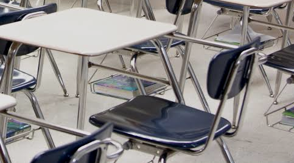

# On For Today 🎯

::: {.callout-tip icon="true"}
## Let's put efficiency to work!

* 🤝 **Work as a team** — Choose one computational problem
* 🔍 **Understand the data** — Make sure the result is correct
* 🧰 **Choose your tools** — Lists, sets, dictionaries, sorting, and more
* ⏱️ **Measure your code** — See how your solution performs
* 🎤 **Share your discoveries** — Give a five-minute presentation
:::

::: {.callout-note icon="false"}
**The Big Idea:** A good solution is not just fast. It is also **correct, understandable, and appropriate for the data**!
:::

---

## Why Does Efficiency Matter? ⚡

:::{.callout-yellow icon="false"}

Why does efficiency matter? Because a solution that works well for small inputs may become impractical for larger ones. For example, a simple search through a list of students may be fine for a single classroom, but if you have to do it for an entire school, the time taken can grow significantly.
:::


::: {.callout-tip icon="false"}
**Graded Activity Details to Follow **

- **Objective:** Demonstrate understanding of efficiency in Python programming.
- **Format:** Group presentation (5 minutes) + individual reflection.
- **Demonstration and Evaluation:** Based on correctness, efficiency, and presentation quality.
- Your Activity grade will be based on your group’s presentation of your solution
:::

<center>
{width=30%}
</center> 


## A Problem in Efficiency, For Example...

::: {.callout-important icon="false"}
Imagine searching a classroom attendance list once for every student in a whole school. A solution that feels instant on a tiny example can take much longer as the data grows!
:::

<center>
{width=30%}
</center> 

::: {.callout-blue icon="false"}

* 📈 **Input size** — What happens when we have 10 times as much data?
* 🔁 **Repeated work** — Can we avoid checking the same information again?
* 🧠 **Memory** — Does a faster approach need extra space?
* ✅ **Correctness first** — A fast answer is only useful if it is right!
:::


<!-- ::: {style="color: #8E44AD;"}
**Key Insight:** Think of efficiency like organizing a toolbox 🧰. The right tool can save many trips back and forth!
:::
 -->


# Part 1: How Do I Improve Efficiency?

<center>
{width=30%}
</center>

:::{.callout-red icon="false"}
**Note: Friday this work will be graded as a group activity. You will have time to work together and present your solution.**
:::

## Problem: The Library's Busy Book List

::: {.callout-yellow icon="false"}
**The Problem:** 

- A library records a book ID each time a book is borrowed.
- Count the number of times each book appears.
:::


::: {.callout-note icon="false"}

* **Input:** A list of book IDs, such as `[101, 205, 101, 310, 205, 101]`
* **Output:** A dictionary mapping each ID to its count: `{101: 3, 205: 2, 310: 1}`
* **Context:** The library wants a quick summary even when there are many loans.
* **Question:** Could we visit each loan once instead of repeatedly scanning the list?
:::

---

## A Possible Solution 

```python
def solve(loans):
    counts = {}
    for book_id in loans:
        counts[book_id] = counts.get(book_id, 0) + 1
    return counts

small = [101, 205, 101, 310, 205, 101]
print(solve(small))
assert solve(small) == {101: 3, 205: 2, 310: 1}
assert solve([]) == {}
```

::: {.callout-tip icon="false"}
**Why might this scale?**

- We visit each loan once: expected **O(n)** time using dictionary operations, with **O(u)** extra space for `u` distinct IDs.
- Repeatedly counting each distinct ID by scanning the whole list could take **O(nu)** time.

:::

---


## Continuing this Example, Let's Try a Larger Input

```python
# Use the solve function from the previous slide.
data = [100 + (i * 17) % 500 for i in range(100_000)]
print("Loans:", len(data))
print("Distinct books:", len(solve(data)))  # 500
```
:::{.callout-blue icon="false"}
- The formula creates **100,000 loans** involving **500 book IDs**.
- Run the shared timing code on the next slide with this `data`.
- Try `200_000` loans too. Does the time roughly double?
:::

::: {.callout-yellow icon="false"}
**Note:** Timings can vary across computers and runs. This means that a single measurement is not enough to draw conclusions. A measurement is evidence, not a guarantee!
:::


<center>
{width=20%}
</center>

---


## Timing Your Solution 

Copy this **after** defining your own `solve` and `data`:

::: {.columns}

::: {.column}


```python
from timeit import repeat

# Test correctness before timing! Create data outside the timer.
times = repeat(lambda: solve(data), repeat=5, number=1)
print(f"Best of 5: {min(times):.6f} seconds per call")
print("All runs (seconds):", times)
```

::: {.callout-blue icon="false"}
- All challenges use `solve(data)` and **return** a result without changing `data`.
- Use the same input and computer when comparing methods; do not time printing or data creation.
- Time at least two input sizes. Report their sizes, timings, and what you observed.
- Fast results may be noisy; rerun if needed. If a method is too slow, stop it and try a smaller input.
:::

:::

::: {.column}


<center>

{width=65%}

</center>


:::

:::


:::{.callout-red icon="false"}
All groups will present their solution and timing results. Be ready to explain your approach, correctness, and efficiency!
:::

# Part 2: Your Group Challenge 

## The Mission


::: {style="color: #8E44AD;"}
**Choose ONE of the eight provided problems to work on:** Build a correct Python function, test it, and explore how its running time changes as the input grows.

:::

<!-- ::: {.callout-important icon="false"} ::: -->


::: {.callout-important icon="false"}

- Read the context, input rules, and expected example together.
- Plan an approach before coding. What work can you avoid repeating?
- Implement `solve(data)` and check the small examples and an edge case.
- Generate the larger input shown on your problem slide and time your solution.
- Prepare a **five-minute presentation** using the discussion prompts.
:::


::: {.callout-note icon="false"}
**Tools:** Python's standard library is enough. No downloads or external datasets are needed!
:::

---

## Your Time & Team Plan 

**Work time: about 30–50 minutes**, followed by presentations on **Friday**

| Phase | Suggested time | What to do |
|---|---:|---|
| Understand & plan | 5–10 min | Choose a problem; predict an approach |
| Build & test | 15–25 min | Code, check examples, and try an edge case |
| Measure & prepare | 10–15 min | Time two sizes and prepare your explanation |


:::{.callout-red icon="false"}
Each person in the group must speak at the presentation.
:::

::: {.callout-tip icon="false"}
If time is short, prioritize a **correct small example** and one clear timing. Then explain what you would test next!
:::

---

## Your Five-Minute Presentation 

- **Problem & context (1 min):** What are you solving, and why?
- **Method (1 min):** What data structure or strategy did you choose?
- **Code & correctness (1.5 min):** Show `solve`, a small test, and its result.
- **Efficiency (1 min):** Show input sizes, measured times, and expected time/space growth.
- **Reflection (0.5 min):** Answer your challenge's discussion question.

::: {.callout-note icon="false"}
**Everyone:** What repeated work did you avoid? What trade-off or edge case matters? If you compared methods, were they tested on the same input?
:::

---

## Choose Your Adventure! 

| # | Challenge | A useful idea |
|---|---|---|
| 1 | 🎮 Rank game scores | Sorting with a key |
| 2 | 📰 Count words in a message | Dictionary counting |
| 3 | 🎟️ Find guests on both lists | Set membership |
| 4 | 📦 Find repeated package IDs | Remember what you've seen |
| 5 | 📅 Combine busy times | Sort and sweep |
| 6 | 🌡️ Find the hottest stretch | Sliding window |
| 7 | 🚲 Find the closest race times | Sort and compare neighbors |
| 8 | 🎵 Find the most popular songs | Count and select |

:::{.callout-note icon="false"}

Get into a group of 3 to 4 people. Each group will choose a different challenge. 
:::

# Challenge 1: The Game Leaderboard 🎮

## Rank the Players

::: {.callout-note icon="false"}
**Context:** A game needs a leaderboard after a busy tournament. Each record is `(name, score)`.
:::

**Your task:** Return a new list sorted by score **highest first**. Break score ties by name in ascending alphabetical order. Names are unique.

```python
small = [("Zoe", 80), ("Ana", 95), ("Bo", 80)]
assert solve(small) == [("Ana", 95), ("Bo", 80), ("Zoe", 80)]
assert solve([]) == []
```

💡 **Hints:** Explore `sorted` and a tuple key. How can one key express two ordering rules?

🗣️ **Discuss:** Why is sorting once preferable to repeatedly searching for the next highest score? What happens with tied scores?

---

## Challenge 1 — Larger Tournament Data

```python
def make_data(n):
    return [(f"player{i:06d}", (i * 37) % 1000)
            for i in range(n)]

data = make_data(20_000)
# Also try make_data(40_000).
```

Use the shared timing slide after defining `solve`. Do not change the original list.

::: {.callout-tip icon="false"}
**Stretch:** Explain the expected **O(n log n)** time of comparison sorting and the additional space used by your approach.
:::

# Challenge 2: The Message Counter 

## Count the Words

::: {.callout-note icon="false"}
**Context:** A student newspaper wants to count words in a collection of short messages.
:::

**Your task:** Given a list of words, return a dictionary of counts. Treat uppercase and lowercase as the same using `.lower()`; each list item is already one word, with no punctuation.

```python
small = ["Python", "is", "fun", "python", "FUN"]
assert solve(small) == {"python": 2, "is": 1, "fun": 2}
assert solve([]) == {}
```

💡 **Hints:** A dictionary can remember each word's count. Explore `dict.get` or `collections.Counter`.

🗣️ **Discuss:** How do you handle capitalization? How does the number of distinct words affect memory?

---

## Challenge 2 — Larger Message Data

```python
def make_data(n):
    return [f"Word{(i * 17) % 1000}" for i in range(n)]

data = make_data(100_000)
# Also try make_data(200_000).
```

Use the shared timing slide after defining `solve`. This input contains **1,000 distinct words**, ignoring case.

::: {.callout-tip icon="false"}
**Stretch:** Compare counting in one pass with repeatedly using `list.count` for each distinct word. Which repeated work can you avoid?
:::

# Challenge 3: The Guest List Overlap 

## Find Guests at Both Events

::: {.callout-note icon="false"}
**Context:** Two campus events have guest ID lists. Organizers want to see who attended both.
:::

**Your task:** `data` is a tuple of two lists of integer IDs. Return a **sorted list of unique IDs** that appear in both lists. Either list may contain duplicates.

```python
small = ([7, 2, 7, 5], [5, 7, 7, 9])
assert solve(small) == [5, 7]
assert solve(([], [1, 2])) == []
```

💡 **Hints:** A `set` can remove duplicates and support fast membership checks. Remember to sort the final result.

🗣️ **Discuss:** How did you handle duplicates? What extra work is needed to return the IDs in order?

---

## Challenge 3 — Larger Guest Lists

```python
def make_data(n):
    return (list(range(n)), list(range(n // 2, n + n // 2)))

data = make_data(50_000)
# Also try make_data(100_000).
```

Use the shared timing slide after defining `solve`. Each list has `n` IDs; exactly `n // 2` overlap for the even sizes above.

::: {.callout-tip icon="false"}
**Stretch:** Explain expected set lookup costs, the cost of sorting the overlap, and the extra space required.
:::

# Challenge 4: The Duplicate Detector 

## Find Repeated Package IDs

::: {.callout-note icon="false"}
**Context:** A warehouse wants to flag IDs that appear more than once in a shipment log.
:::

**Your task:** Return each repeated integer ID **once**, in the order in which its **second occurrence** is encountered.

```python
small = [3, 1, 3, 2, 1, 3]
assert solve(small) == [3, 1]
assert solve([8, 8, 8]) == [8]
assert solve([]) == []
```

💡 **Hints:** Keep track of IDs already seen and IDs already reported. A set can make each check fast.

🗣️ **Discuss:** Why is the order of the second occurrence important? What if an ID appears three or more times?

---

## Challenge 4 — Larger Shipment Log

```python
def make_data(n):
    return [i % 10_000 for i in range(n)]

data = make_data(100_000)
# Also try make_data(200_000).
```

Use the shared timing slide after defining `solve`. There are **10,000 distinct IDs** in each suggested input.

::: {.callout-tip icon="false"}
**Stretch:** Compare the expected cost of checking membership in a set with repeatedly checking a growing list.
:::

# Challenge 5: The Busy Calendar 

## Combine Overlapping Times

::: {.callout-note icon="false"}
**Context:** A shared study room has many reservations. Combine overlapping reservations to show when the room is busy.
:::

**Your task:** Given `(start, end)` integer pairs with `start < end`, return merged intervals sorted by start. Treat intervals as half-open `[start, end)`; **merge touching intervals too**.

```python
small = [(5, 7), (1, 3), (2, 6), (9, 10), (10, 12)]
assert solve(small) == [(1, 7), (9, 12)]
assert solve([]) == []
```

💡 **Hints:** Sort by start, then sweep through once while tracking the current interval's end.

🗣️ **Discuss:** Why does sorting help? What happens when one interval is contained inside another?

---

## Challenge 5 — Larger Calendar

```python
def make_data(n):
    return [(i * 2, i * 2 + 3) for i in range(n - 1, -1, -1)]

data = make_data(20_000)
# Also try make_data(40_000).
```

Use the shared timing slide after defining `solve`. These reverse-ordered intervals overlap into one interval for `n > 0`.

::: {.callout-tip icon="false"}
**Stretch:** Identify the sorting and sweep costs separately. Does your code leave the original list unchanged?
:::

# Challenge 6: The Hot Streak 

## Find the Largest Window Sum

::: {.callout-note icon="false"}
**Context:** A weather station wants to find the warmest consecutive stretch of `k` days.
:::

**Your task:** `data` is `(values, k)`, where `values` is a list of integers and `1 <= k <= len(values)`. Return the **largest sum** of any `k` consecutive values. Values may be negative.

```python
assert solve(([2, 1, 5, 1, 3, 2], 3)) == 9
assert solve(([-4, -2, -7], 2)) == -6
assert solve(([7], 1)) == 7
```

💡 **Hints:** Calculate the first window once. When the window moves, subtract the value leaving and add the value entering.

🗣️ **Discuss:** What work does a sliding window avoid? Why must you test negative values?

---

## Challenge 6 — Larger Weather Record

```python
def make_data(n):
    return ([(i * 13) % 61 - 20 for i in range(n)], 100)

data = make_data(100_000)
# Also try make_data(200_000); n must be at least 100.
```

Use the shared timing slide after defining `solve`. The window width is **100 days** for both sizes.

::: {.callout-tip icon="false"}
**Stretch:** Compare summing every window from scratch with updating a running sum. What changes if `k` grows with `n`?
:::

# Challenge 7: The Closest Race Times 

## Find the Smallest Difference

::: {.callout-note icon="false"}
**Context:** A race organizer wants to find how close the nearest two finishers were.
:::

**Your task:** Given a list of at least two integer finish times, return the **smallest absolute difference** between two times. Equal times are allowed.

```python
assert solve([42, 17, 25, 20]) == 3
assert solve([10, 3, 10]) == 0
assert solve([8, 2]) == 6
```

💡 **Hints:** Sort a copy of the times. Which pairs need to be compared after sorting?

🗣️ **Discuss:** Why are neighboring values enough? How does sorting compare with checking every pair?

---

## Challenge 7 — Larger Race

```python
def make_data(n):
    return [(i * 7919) % 1_000_003 for i in range(n)]

data = make_data(20_000)
# Also try make_data(40_000); n must be at least 2.
```

Use the shared timing slide after defining `solve`. The original list should still be in its original order.

::: {.callout-tip icon="false"}
**Stretch:** Can you justify the time and space needed for sorting plus one pass?
:::

# Challenge 8: The Playlist Favorites 

## Find the Top Songs

::: {.callout-note icon="false"}
**Context:** A campus radio station wants to report its most frequently played songs.
:::

**Your task:** `data` is `(plays, k)`, where `plays` is a list of song names and `k >= 0`. Return up to `k` **distinct names**, ordered by play count descending, then name ascending for ties. Names are case-sensitive.

```python
small = (["Echo", "Wave", "Echo", "Sun", "Wave", "Rain"], 3)
assert solve(small) == ["Echo", "Wave", "Rain"]
assert solve((["A", "A"], 5)) == ["A"]
assert solve(([], 2)) == []
assert solve((["A"], 0)) == []
```

💡 **Hints:** Count with a dictionary or `Counter`, then sort by `(-count, name)`. Consider a heap as a stretch.

🗣️ **Discuss:** How did you break ties? When might selecting only the top `k` be useful?

---

## Challenge 8 — Larger Playlist

```python
def make_data(n):
    plays = [f"Song{(i * 17) % 1000:04d}" for i in range(n)]
    return (plays, 10)

data = make_data(100_000)
# Also try make_data(200_000).
```

Use the shared timing slide after defining `solve`. There are **1,000 distinct songs** in each suggested input.

::: {.callout-tip icon="false"}
**Stretch:** Compare sorting all `u` distinct songs with selecting `k` using a heap. Include counting, tie rules, and memory in your explanation.
:::

# Part 3: Present & Reflect 

## Present Your Solutions!

::: {.callout-important icon="false"}
Each group has about **five minutes** to introduce its problem, explain its method, show working code and a test, and share measured execution times.
:::

- 🔍 What input did you test, and what result did you expect?
- ⏱️ How did runtime change as the input grew?
- 🧠 What time and memory trade-offs did you notice?
- 💡 What would you improve or investigate with more time?

::: {.callout-note icon="false"}
**Takeaway:** Efficient programming is a process: **understand, plan, test, measure, and improve**. There can be more than one good solution!
:::
